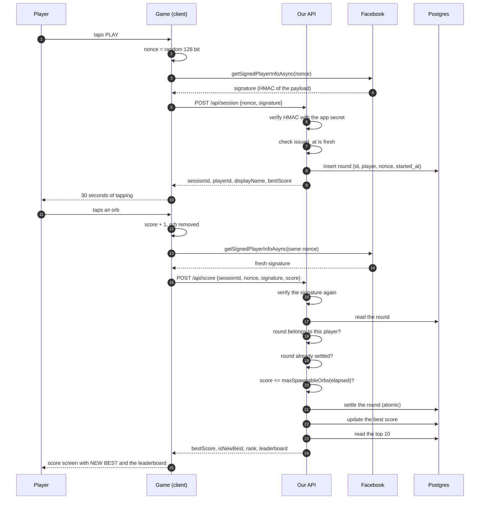

# Architecture

## The constraint that shapes everything

Facebook's Instant Games platform moved to **Network Enabled Zero Permissions
(NEZP)**, and the old standard connection was switched off on **30 September
2026**. NEZP is not optional any more: a game on the old platform version is
simply not reachable.

NEZP removes:

- `player.getName()` and `player.getPhoto()` - we never get a name or a photo
- the native score APIs - `getGameScoreAsync`, `setScoreAsync`,
  `getLeaderboardAsync` and friends are gone
- `player.getSignedPayload()` - the old, unauthenticated signed payload

What is left is `player.getSignedPlayerInfoAsync(requestPayload)`, which
returns a payload that Facebook signs with the app secret.

So there is no leaderboard to read and no identity to trust unless we build
both. That is what this repository is.

## Trust model

### The signature

`getSignedPlayerInfoAsync` returns a signed request in the OAuth2 style:

```
base64url(hmac_sha256(payload, app_secret)) + "." + base64url(payload_json)
```

The payload contains the `request_payload` we passed in, an `issued_at`
timestamp and the player's id.

The server recomputes the HMAC with the app secret and compares it in
constant time. The app secret never leaves the server, so a client cannot
mint a signature for itself.

Two details are ambiguous in Meta's documentation, and both are handled
defensively in `src/trust.ts`:

- **Which string the HMAC covers.** The reference calls it "the whole
  response payload string", which could mean the base64url segment or the
  decoded JSON. Both are accepted.
- **Which segment comes first.** The documentation puts the signature first,
  the classic Facebook `signed_request` format puts the payload first. Both
  are accepted.

Accepting both is not a weakness: the HMAC still has to match the app
secret, so the only thing that widens is which encodings of a genuine
signature we understand.

### The nonce

Every round starts with a fresh 128 bit random nonce generated on the client.

```
nonce -> getSignedPlayerInfoAsync(nonce) -> signature
```

The server checks that the `request_payload` inside the signed payload is
exactly the nonce it expects. The same nonce is used for the session request
and for the score submission, which is what binds a score to a round:

- a signature for a different nonce is rejected
- a score submitted with a different nonce than the session is rejected
- a signature is only accepted for ten minutes after `issued_at`

### The identity

The player id is read out of the **signed payload**, never out of the request
body. A client that claims to be another player gets the id of the player
whose signature it actually presented.

Meta's payload key for the player id is not documented as stable, so the
implementation looks for a list of known keys and, failing that, accepts a
claimed id only when that exact string appears somewhere inside the signed
payload. Either way the id is authenticated by the HMAC.

### The score

A score is only plausible if the orbs it claims to have tapped could have
existed. The spawn schedule lives in `shared/rules.ts` and is used by both
sides:

```ts
spawnIntervalMs(progress); // 800ms at the start, 420ms at the end
orbLifetimeMs(progress); // 2200ms at the start, 1400ms at the end
maxConcurrentOrbs(progress); // 2 at the start, 4 at the end
maxSpawnableOrbs(elapsed); // how many orbs could have appeared by now
```

The server computes `maxSpawnableOrbs(elapsed)` for the round and rejects
anything above it. Because the round is created on the server _before_ the
player starts playing, the server's elapsed time is always at least the
client's, which keeps the bound an upper bound and never a false rejection.

Three more rules on the server:

| Rule                               | Why                                      |
| ---------------------------------- | ---------------------------------------- |
| Round must be older than 2 seconds | No "open and instantly claim 999 points" |
| A round can only be settled once   | Atomic update, no replay                 |
| At most 60 rounds per hour         | Stops a leaderboard being flooded        |
| Best score only ever goes up       | A worse score never lowers a record      |

### What this does not stop

A determined attacker with a real Facebook account and a modified client could
still play perfectly by scripting the taps. The rules above remove the cheap
attacks (inflated scores, replayed submissions, impersonation) but they are
not a proof of play. Making that stronger would need a server-side replay of
the round, which costs far more than it buys for a 30 second reflex game. The
trade-off is written up in [decisions.md](decisions.md).

## Request flow



## Modules

| Module                    | Responsibility                                      |
| ------------------------- | --------------------------------------------------- |
| `shared/rules.ts`         | The numbers both sides agree on                     |
| `shared/contract.ts`      | The shapes of every request and response            |
| `src/trust.ts`            | Verification of Facebook-signed payloads            |
| `src/config.ts`           | Environment configuration and the CORS allowlist    |
| `src/http.ts`             | CORS, JSON bodies, error responses                  |
| `src/handlers.ts`         | The five endpoints                                  |
| `src/store.ts`            | The storage interface                               |
| `src/store-memory.ts`     | In-memory store for development and tests           |
| `src/store-postgres.ts`   | Postgres store on top of the Neon serverless driver |
| `src/display-name.ts`     | Cleaning up player chosen names                     |
| `api/*.ts`                | One Vercel function per endpoint                    |
| `apps/game/src/engine.ts` | The game rules as a DOM free state machine          |
| `apps/game/src/fb.ts`     | A defensive wrapper around the Facebook SDK         |

The handlers work on structural request and response types rather than
Vercel's own types, which keeps them testable without a serverless runtime.
`api/*.ts` are three line adapters onto those handlers.

## Data model

```sql
players (player_id PK, display_name, best_score, best_at, created_at, updated_at)
rounds  (id PK, player_id FK, nonce UNIQUE, started_at, settled_at, score)
```

- `players.best_score` is the record. `best_at` breaks ties in favour of the
  player who got there first.
- `rounds` exists so a score can be tied to a round, settled exactly once and
  rate limited. `nonce` is unique, which makes the round identifiable even if
  a client sends the same session twice.
- The leaderboard is a single indexed query:
  `ORDER BY best_score DESC, best_at ASC LIMIT 10`.

The rank of a player is the number of players with a better score, plus one.
It is computed on demand instead of being stored, which keeps it correct when
other players move up and down.

## The game

Portrait, one tap target, thirty seconds. The engine
(`apps/game/src/engine.ts`) is a state machine driven by a wall clock and
knows nothing about the DOM, the canvas or Facebook. The renderer draws the
orbs, the HUD is plain DOM, and the sound effects are synthesised with the
Web Audio API.

No images and no audio files are shipped, which keeps the bundle at about
19 KB of JavaScript and 11 KB as a zip.
